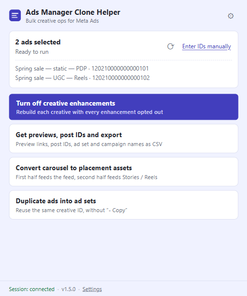
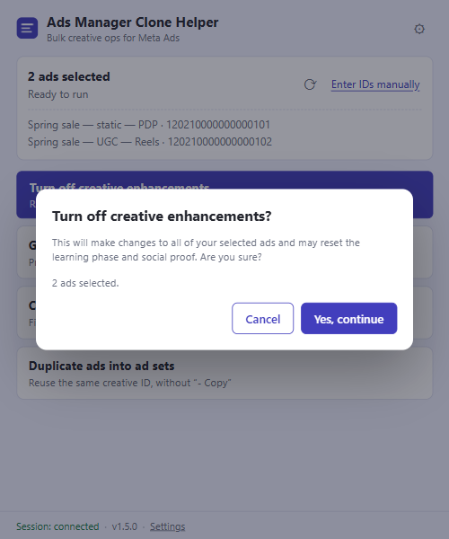
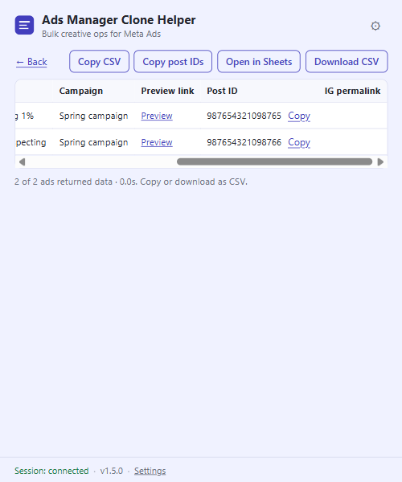
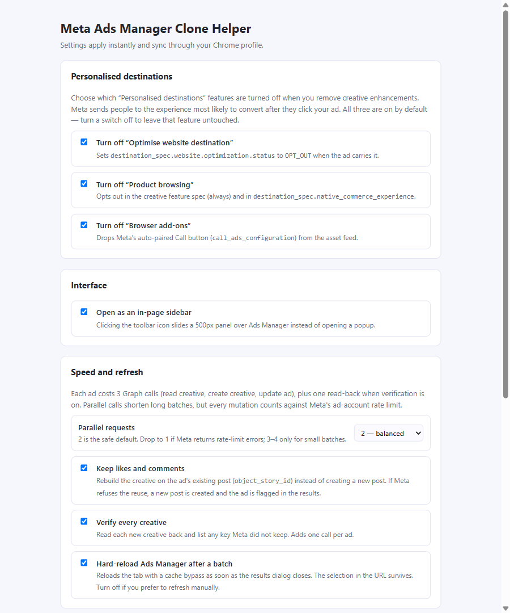

# Meta Ads Manager Clone Helper

A clean-room Chrome extension that adds four bulk workflows to **Meta Ads Manager**:
turn off creative enhancements, export previews and post IDs, convert carousels to
placement assets, and duplicate ads across ad sets.

Runs entirely in your browser. No account, no server, no analytics, no Kitchn.io code.



`Manifest V3` · `Chrome 116+` · `MIT`

---

## What it does

| Action | What it does |
| --- | --- |
| **Turn off creative enhancements** | Rebuilds each selected ad's creative with **82 enhancement keys opted out**, removes asset-feed audio and promo metadata, drops auto-generated thumbnails, disables multi-share end cards, clears sourcing (site links, catalog items, promo codes). Shows a confirmation first, then reads every new creative back and reports anything Meta did not keep. |
| **Get previews, post IDs and export** | Fetches the shareable preview link, post ID, Instagram permalink, ad set and campaign name for every selected ad. Copy CSV, download CSV, open in Sheets, or **Copy post IDs** as short numeric IDs (one per line). |
| **Convert carousel to placement assets** | Rebuilds a 4/6/8/10-card carousel so the first half feeds default placements and the second half becomes a vertical carousel for Stories/Reels. Uses `optimization_type: PLACEMENT` and one customization rule per placement. |
| **Duplicate ads into ad sets** | Creates new ads in one or more target ad sets using the **same creative ID**, so the post and its social proof are reused. Only conversion tracking specs are carried over. Search, filter and group ad sets by campaign. |

Everything the extension creates stays **PAUSED**. It never publishes or activates an ad.

---

## Install

1. Download this repository (Code → Download ZIP) and unzip it, or clone it.
2. Open `chrome://extensions` in Chrome, Edge or Brave.
3. Turn on **Developer mode** (top right).
4. Click **Load unpacked** and select the **`extension`** folder — the one containing `manifest.json`.
5. Pin the extension from the puzzle-piece menu.

No build step, no dependencies.

> The extension needs Chrome **116 or newer** and an Ads Manager tab where you are
> signed in.

---

## Quick start

1. Open `adsmanager.facebook.com` and **select ads** in the table.
2. Click the extension icon.
   - Default mode is an in-page **sidebar**. Turn it off in Settings if you prefer a popup.
3. Pick an action. The first time, the confirmation and results dialogs explain exactly what will happen.
4. When the results dialog closes, the Ads Manager tab **hard-reloads** so the table is fresh. Your selection survives in the URL.

If the footer says **“Session: open Ads Manager”**, reload the Ads Manager tab once,
wait for the table, then reopen the helper. It reads the session from the page's own
Graph requests — there is no login.

---

## Feature guide

### Turn off creative enhancements



- A confirmation lists how many ads are selected before anything runs.
- Each ad gets a **new creative** with every known Advantage+ creative feature set to
  `OPT_OUT`, plus the extra cleanups listed above.
- **Likes and comments:** by default the new creative points at the ad's existing post
  (`object_story_id`), so engagement stays on the same post. If Meta refuses the reuse,
  a new post is created and the row is flagged. This can be turned off in Settings.
- **Read-back:** the extension checks every key it sent. Missing or still-enrolled keys
  appear under **Not off after the rebuild**. **Copy details** copies the raw JSON.

The confirmation warns that creative changes may reset the learning phase and social
proof. That is true of any creative replacement, including Ads Manager's own editor.

### Get previews, post IDs and export



- Table columns: ad ID, ad name, ad set, campaign, preview link, post ID, Instagram link.
- **Copy CSV** / **Download CSV** for Sheets or reporting.
- **Copy post IDs** copies just the numeric ID (`1538833348267056`), one per line,
  stripping the `pageid_` prefix. Every row also has its own **Copy** button.
- **Open in Sheets** copies the CSV and opens a new Google Sheet.

### Convert carousel to placement assets

- Requires a **4, 6, 8 or 10-card** carousel with a call to action.
- Tick the placements you want: default, Instagram Stories/Reels/profile Reels,
  Facebook Stories/Reels, Audience Network.
- The first half of the cards becomes the default carousel; the second half becomes the
  vertical carousel for the selected placements.
- Non-carousel ads are skipped with a prompt instead of failing the batch.

### Duplicate ads into ad sets

- Choose one or more target ad sets (search, status filter, campaign grouping,
  select-all, load more).
- New ads reuse the source **creative ID**, so the post and engagement are shared.
- Only `offsite_conversion` and `offline_conversion` tracking specs are copied;
  engagement/link-click specs are stripped.
- Duplicated ads are created **PAUSED**.

---

## Settings



**Personalised destinations** (all on by default)
- Turn off “Optimise website destination”
- Turn off “Product browsing”
- Turn off “Browser add-ons” (the auto-added Call button)

**Interface**
- Open as an in-page sidebar instead of a popup.

**Speed and refresh**
- **Parallel requests** — 1 to 4, default 2. Higher is faster but hits Meta's
  ad-account mutation limit sooner.
- **Keep likes and comments** — reuse the ad's existing post when possible.
- **Verify every creative** — read each new creative back (one extra call per ad).
- **Hard-reload Ads Manager after a batch** — on by default.

**Recent enhancement runs**
- Last 500 runs, stored locally: ad ID, old creative ID, old post ID, new creative ID.
- **Copy post ID** recovers a post that was replaced, so it can be re-attached with
  “Use existing post”.

**Session**
- Forget the current token. Tokens live in `chrome.storage.session` only.

---

## How the session works

Ads Manager authenticates its own Graph requests with a token in the URL. The extension
observes those requests with `webRequest`, keeps the token in **session storage** (memory,
cleared when the browser closes) and sends it as an `Authorization: Bearer` header — only
to `graph.facebook.com`.

| Permission | Why |
| --- | --- |
| `storage` | settings, session token, local run log |
| `tabs` | read the current tab URL (ad selection) and reload the page |
| `webRequest` | observe the Ads Manager Graph request that carries the token |
| `clipboardWrite` | copy previews and post IDs from the sidebar iframe with the legacy command, because the host page’s Permissions-Policy blocks the async Clipboard API there |
| `host_permissions` | `*.facebook.com` (page + token) and `graph.facebook.com` (API) |

There is no `<all_urls>`, no `scripting`, no remote server and no third-party analytics.

---

## Limits and good to know

- **Meta has no draft state in the API.** Ads Manager drafts exist only in the UI and
  cannot be created or edited by an extension. API-created objects are always real
  objects; this extension creates them `PAUSED`, which cannot spend.
- **Batch size:** 25–50 ads per run is a practical start. Meta's ad-account mutation rate
  limit is the real ceiling; rate-limited calls are retried with 2s/4s backoff. One
  failing ad never stops the others.
- **Large selections:** Meta collapses big selections into a URL hash. Use **Enter IDs
  manually** and paste IDs separated by commas, spaces or newlines.
- **Creative replacements** can restart learning and, when a new post is unavoidable,
  reset likes/comments. The extension warns and reports which ads kept the post.
- **Carousel conversion** requires a call to action; placement-customised ads may be
  rejected by Meta.
- **Previews** are fetched 50 ads per call.
- **Calls per ad:** enhancements 3 (+1 read-back), duplicate 1 read per source + 1 POST
  per source × ad set, previews 1 per 50 ads.

---

## Troubleshooting

| Symptom | Fix |
| --- | --- |
| “No Ads Manager session found” | Reload `adsmanager.facebook.com`, wait for the table, reopen the helper. |
| “The background worker did not answer” | Reload the extension on `chrome://extensions`, then reload the tab. |
| Ads Manager still shows the old creative | The table caches in memory. Close and reopen the ad editor, or use **Hard reload** (on by default). |
| “Not off after the rebuild” | Click **Copy details** and check `notOff` / `specPresent`. Meta may have dropped the spec or returned an existing creative for that post. |
| Rate-limit errors | Settings → Parallel requests = 1, smaller batch, retry later. |
| Ad names empty or internal keys appear | Older versions showed `__fb_trace_id__`; v1.4+ filters them. Update and reload. |

---

## Privacy

- No backend, no account, no telemetry.
- The token never leaves your browser except as the auth header to `graph.facebook.com`.
- Settings sync through Chrome; the token and run log stay local.
- No Kitchn.io code, assets or branding are included.

---

## Development

```bash
npm test          # 37 assertions: selection, payloads, CSV, Graph client, concurrency
node tools/check.mjs   # manifest paths, JS syntax, imports, element ids, key list
```

Structure:

```
extension/          loadable Manifest V3 extension
  manifest.json
  src/
    background.js   service worker: token capture, message router
    sidebar.js      in-page sidebar overlay
    features/       enhancements, carousel, duplicate
    lib/            Graph client, errors, CSV, IDs, concurrency pool
  ui/               popup, options, styles
  icons/
tools/              checks, self-tests, icon generator, dev server
docs/screenshots/   README images
```

Rebuild icons with `node tools/make-icons.mjs`. Serve the UI for development with
`node tools/serve.mjs 8787` and open `http://127.0.0.1:8787/ui/popup.html`
(the popup needs a Chrome API stub when opened outside Chrome).

---

## FAQ

**Is it free?** Yes, MIT licensed. Use it, fork it, change it.

**Does it publish or spend?** No. Every created object is `PAUSED`; activation is manual.

**Does it work in Edge/Brave?** Any Chromium browser with Manifest V3 and Chrome 116+.

**Why does my ad lose likes/comments?** Likes live on the post, not the creative. Any
creative replacement can create a new post. This extension tries to reuse the existing
post first and records what it replaced.

**Can it create true drafts?** No. Meta's API cannot create Ads Manager drafts. Paused is
the closest state that cannot spend.

**Is this the Kitchn.io extension?** No. It is an independent clean-room implementation of
the same four workflows, with no shared code or backend.

---

## Disclaimer

Not affiliated with Meta or Kitchn.io. Use it only on ad accounts you own or are authorised
to manage. Meta's Platform Terms and advertising policies apply to every Graph call made by
the extension. Read the code and test on paused ads before running large batches.

## License

MIT — see [LICENSE](LICENSE).
